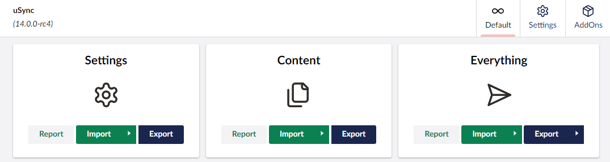
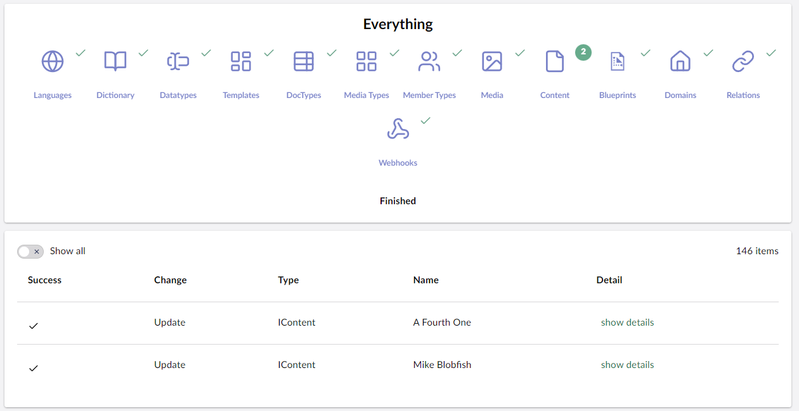
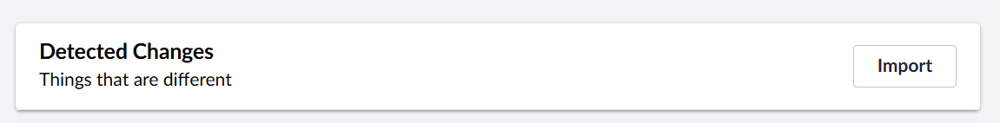

## What is a Report? 

Within uSync a report will tell you what differences exist between the files in the uSync folder and the settings within your Umbraco setup. No changes are made to your Umbraco setup when you run a report.

##  Running a Report

To run a report you click on the report button either within a specific group (i.e settings) or for everything. 

## Understanding a Report 

The report will then run and show you the differences between the files on disk and your setup. 

The list at the bottom of the page will show you the items that are different between the files on disk and your setup. The report will tell you what would change if you were to import the changes from disk onto your Umbraco site. 

|Item|Note|
|--|--|
|Type|The type of item inside Umbraco e.g a Content item or a ContentType.|
|Name|Name of the item.|
|Change|The type of change that will occur if the item is imported (e.g update, create, delete).|
|Message|Any additional messages that uSync may want to report about an item|
|Details|Link to the details of the change.|

## Change Details
For each change in a report uSync can show you the details of the change, so you can see exactly what is different between the files on disk and your setup. If you click on the details link you will be shown the individual changes on an item.

From uSync v17.6, items that have a visual preview open on the **Changes** tab, which shows the current and incoming versions of the item. The **Diff** tab shows the change list described below. Items without a preview go straight to the change list.

### The change list

Each change is shown as a row. The row shows the name of the property or setting that has changed, and a short summary of the change (e.g. 'Value changed', '3 changes' or '+4 / -2 lines'). If a property varies by culture, the culture is shown as a tag next to the property name.

Click on a row to expand it and see the detail of the change, and click again to collapse it. If an item only has one change, that row is opened for you. Any change that failed or has an error is marked with a red icon and opened automatically.

When a row is expanded, the bottom of the row shows the path to the value inside the uSync file, with a button to copy it.

### How changes are shown

From uSync v17.4, the change list compares values based on what they contain, rather than as one block of text.

|Value|How it is shown|
|--|--|
|Simple values|The old and new value, with new content marked in green and removed content in red with a line through it.|
|JSON values (e.g. Block List and Block Grid content)|Each difference inside the value is listed on its own, so adding one block to a list shows as one added item, not a change to the whole list. If blocks have only been moved, uSync shows an 'Items reordered' notice instead of listing every value that moved.|
|Long text and XML|A line-by-line diff. Runs of unchanged lines are collapsed, and you can click 'Show unchanged lines' to see them.|

For JSON values, the **Show raw values** button shows the full old and new JSON, so you can see the whole value as well as the individual differences.

Some values can't be compared. Hidden values (such as passwords) are shown as 'Hidden value', and very large values are shown in full rather than compared. 

### Individual Import

After a report, you can import individual changes by clicking on the import button in top right corner of the details. Clicking this button will import **only** that change. If there are any dependencies, those will need resolving manually for everything to work properly. 